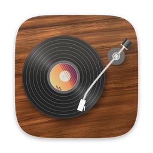
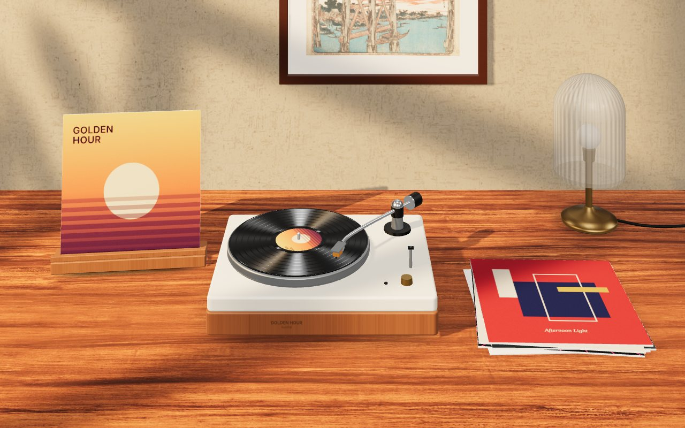
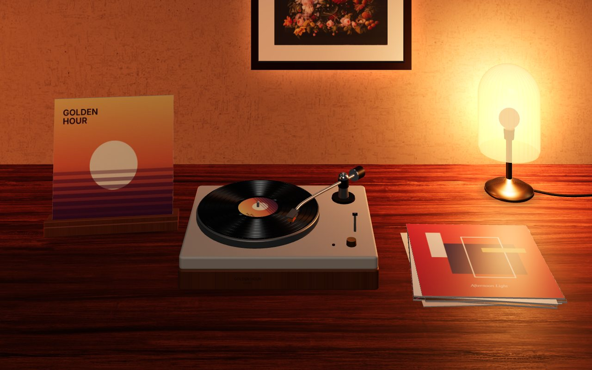
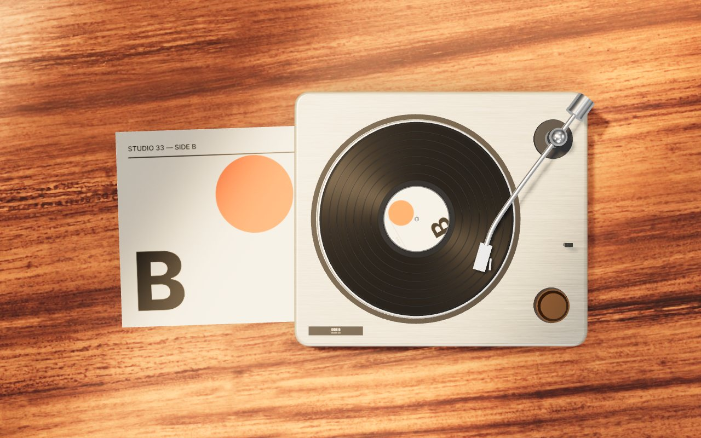
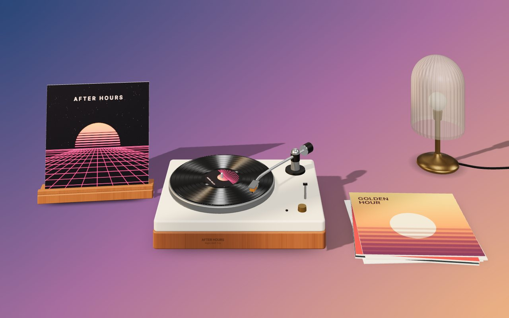

<p align="center">
  
</p>

<h1 align="center">Vinyl</h1>

<p align="center">
  A spinning turntable for your Mac desktop that plays along with Spotify and Apple Music.<br>
  Free and open source.
</p>



Vinyl puts a turntable right on your desktop, behind your windows and on top of
your wallpaper. Play something in Spotify or Apple Music and the record spins,
the album goes up on the stand, the tonearm tracks through the song, and the
last few albums you played pile up beside the deck. No account, no login, no
API key.

## Four ways to listen

| | |
| --- | --- |
| **Listening Room**: golden afternoon sun through a window, with shadows from a plant moving gently across the wall. |  |
| **After Hours**: the same desk late at night, lit by a glass lamp and a warm glow behind the print. |  |
| **Turntable**: the classic top-down view of the deck and its sleeve on a sunny desk, striped by window blinds. |  |
| **Mini Player**: a small turntable (or just the record) floating above your windows. It works like a widget: drag it anywhere, click the record to play or pause, hover for controls, and drag the corner or pinch to resize it. |  |

Turn off the room background and the turntable, sleeves and lamp sit straight
on your own wallpaper, with real shadows:



## Features

- **Live album art**: covers show up on the record label, the stand and the sleeve, and change smoothly when the album changes. The previous cover stays up while the next one loads.
- **Spotify and Apple Music**: the active player is detected automatically. You can also make Vinyl follow just one of them.
- **A tonearm that follows the song**: press play and it lifts off its rest, swings over the record and lowers into the groove. It moves inward as the track goes on, cues again when you skip or seek, and swings back to its rest when you pause.
- **Recently played**: up to five of your last albums stacked beside the turntable. The stack is remembered between launches.
- **Resizable**: a Size slider for every desktop scene, which zooms the rooms in on the turntable and makes the top-down deck as small or as big as you like.
- **Transparent mode**: hide the room and keep only the objects on your wallpaper.
- **Mini player options**: a small turntable or just the record, plain label or full picture disc, any size from tiny to large, keep on top, and show on every Space.
- **Multiple displays**: show Vinyl on your main display or on all of them.
- **Lives in the menu bar**: close the window and Vinyl keeps running. It can also open at login.
- **Easy on the battery**: drawing stops completely when Vinyl is covered or the display sleeps, and it drops to 30 fps on battery. Reduce Motion is respected.
- **Works on its own**: with nothing playing, it spins built-in records.

## Install

Download `Vinyl.dmg` from the [latest release](https://github.com/CycloneDraco/Vinyl/releases/latest).
Requires macOS 14 Sonoma or later; works on Apple silicon and Intel.

Vinyl is ad-hoc signed but not notarized by Apple, so macOS blocks the first
launch. You need to allow it once per version, including after each update.

1. Open `Vinyl.dmg`, drag **Vinyl** into **Applications**, then open Vinyl from **Applications** rather than from the disk image.
2. **macOS 15 Sequoia, 26 Tahoe or later:** when macOS says *"Vinyl" Not Opened*, click **Done**, not Move to Trash. Open **System Settings → Privacy & Security** and scroll down to **Security**. Next to *"Vinyl" was blocked to protect your Mac*, click **Open Anyway**, click **Open Anyway** again in the warning that follows, then enter your password and click **OK**. This needs an administrator, so on a standard account enter an admin's name and password. The button is only there for about an hour after the blocked launch, so if you don't see it, try opening Vinyl again. Right-click → Open no longer gets around the block on these versions.
3. **macOS 14 Sonoma:** in Finder, Control-click (or right-click) **Vinyl** in Applications, choose **Open**, then click **Open**. The **Open Anyway** button in Privacy & Security also works.
4. If macOS says Vinyl "is damaged", don't bypass it. Delete Vinyl and download `Vinyl.dmg` again from the Releases page. If a fresh copy is still blocked and no **Open Anyway** button appears, run this in Terminal and then open Vinyl again. It skips macOS's first-launch malware check, so only do it for a copy from the Releases page.
   ```sh
   xattr -dr com.apple.quarantine /Applications/Vinyl.app
   ```

Each release also has `SHA256SUMS.txt`; check a download with `shasum -a 256 -c SHA256SUMS.txt`.
Builds of every commit are also available from the [Build workflow](https://github.com/CycloneDraco/Vinyl/actions/workflows/build.yml) (the **Vinyl** artifact; you have to be signed in to GitHub).

## Spotify & Apple Music

Vinyl works the moment you press play. Spotify and Music announce every track
change to other apps on your Mac, and Vinyl simply listens. Vinyl needs no
account, API key or developer setup; the only things it looks up online are
album covers (see [Privacy](#privacy)).

Spotify covers come from Spotify's public embed service. For Apple Music, Vinyl
uses the exact artwork stored with the playing track. If that isn't available,
it falls back to the iTunes catalogue, and only accepts a result whose album
and artist both match.

**Connecting (optional).** In **Settings › Music**, click **Connect** next to
Spotify or Apple Music. macOS asks once whether Vinyl may control that app.
Allowing it lets Vinyl:

- show what's already playing when Vinyl starts,
- keep the tonearm exactly in time,
- use Apple Music's embedded artwork, and
- make the play, pause and skip buttons work in the menu bar and mini player.

You can change this at any time in **System Settings › Privacy & Security › Automation**.

## Using Vinyl

- **Menu bar icon**: what's playing, transport controls, scene picker, size and quick toggles.
- **Settings window**: everything else. It opens on first launch, and when you open Vinyl again from Finder or Spotlight while it's running.
- **Mini player**: drag it anywhere. Click the record to play or pause, hover to see the controls, drag the bottom-right corner (or pinch on a trackpad) to resize it, and right-click for options.
- **Nothing running?** Press play (or click the record) and Vinyl opens Spotify, or Music if that's what you use, and starts playing.

## Build from source

You need Xcode 16 or later on macOS 14 or later.

```sh
git clone https://github.com/CycloneDraco/Vinyl.git
cd Vinyl
open Vinyl.xcodeproj   # then press ⌘R
```

Or from the terminal:

```sh
xcodebuild -project Vinyl.xcodeproj -scheme Vinyl -configuration Release \
  -derivedDataPath build CODE_SIGN_IDENTITY=- build
open build/Build/Products/Release/Vinyl.app
```

The project signs ad hoc ("Sign to Run Locally"), so no Apple Developer
account is needed. macOS ties the Automation permission to the signature. If
you rebuild often, choose your own team under *Signing & Capabilities* so you
aren't asked again after each build.

## How it works

```
Vinyl/                      Swift app (SwiftUI + AppKit)
  App/                      entry point, AppModel (glues everything together)
  NowPlaying/               Spotify & Music integration, artwork, recent albums
  Rendering/RendererHost    transparent WKWebView + vinyl:// scheme + JS bridge
  Windows/                  desktop-level scene windows, floating mini player
  Views/                    menu bar panel, settings window, controls
  Settings/Preferences      user settings
Renderer/                   the scenes: three.js, runs inside the app's web view
  js/scenes/                room.js (Listening Room, After Hours), topdown.js, mini.js
  js/models/                turntable (platter, record, tonearm), desk props
  js/textures.js            procedural grooves, gobos, built-in covers
```

- **Desktop scenes** are borderless windows at the desktop level, one per display: above the wallpaper, below desktop icons and every app. They ignore the mouse, appear on every Space, and pause when fully covered.
- **The mini player** is a non-activating floating panel. It uses the same renderer, with SwiftUI controls on top.
- **The renderer** is plain ES modules plus three.js, loaded from the app bundle through a custom `vinyl://` URL scheme. Native code sends it state with `window.vinyl.update({...})`, and it replies with `hello`, `ready` and `error` messages.

## Working on the renderer

The scenes are plain HTML and JavaScript, so you can work on them in any
browser with live reload and no Xcode:

```sh
npm install
npm run serve
# open http://localhost:8080/?demo&scene=listening-room
```

Demo mode plays the built-in records. Keys: **space** play/pause · **n** next ·
**1–4** scenes · **-** / **=** size · **b** background · **l** label/picture disc ·
**a** mini: turntable/record only · **s** stop.

`npm run snapshots` renders every scene to `snapshots/` with headless Chromium.
CI runs this on every push, so pull requests come with previews.

Ideas welcome: new rooms, a cassette deck, more turntable models…

## Continuous integration

Every push runs two workflows:

- **Build**: compiles a universal (Apple silicon + Intel) Release build with Xcode 16.4, then mounts the DMG it produced and checks the app inside (signature, entitlements, architectures, minimum macOS). It launches that packaged app natively and under Rosetta, and uploads `Vinyl.dmg`, `Vinyl.zip` and `SHA256SUMS.txt`. Pushing a `v*` tag publishes them as a GitHub Release, with notes from `docs/release-notes/<tag>.md`.
- **UI smoke test**: launches the real app on a macOS runner and posts Spotify's playback notifications for real tracks, which exercises the no-login artwork lookup. It then hovers over and clicks the mini player, and uploads screenshots of every scene as the `smoke-screens` artifact.

## Privacy

Vinyl has no account and no analytics. It reads playback notifications locally
on your Mac and only goes online to look up artwork: it sends the Spotify track
ID to Spotify's oEmbed service and, when it needs to search, the artist, album
and track name to Apple's iTunes Search API, then downloads the cover from
Spotify's or Apple's image servers. Covers are cached in
`~/Library/Caches/io.github.cyclonedraco.vinyl/Artwork` (the 300 most recently
used).

## Credits

- Inspired by [Vinyl for Mac](https://vinylformac.com) by Shiv Shanmugam. This
  is an independent, open-source project. It isn't affiliated with that app,
  Spotify or Apple, and it shares none of their code or artwork.
- [three.js](https://threejs.org) (MIT), CC0 textures from [Poly Haven](https://polyhaven.com),
  and public-domain prints from [The Met Open Access](https://www.metmuseum.org/about-the-met/policies-and-documents/open-access).
  See [THIRD_PARTY_NOTICES.md](THIRD_PARTY_NOTICES.md).

## License

[MIT](LICENSE)
